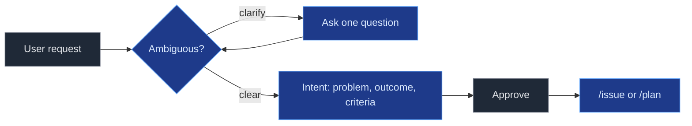
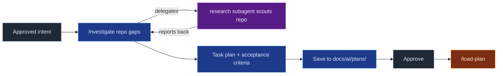
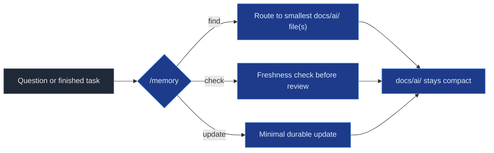

# wayforge

`wayforge` installs a repeatable, task-based AI-assisted workflow into OpenCode projects. It provides shared agents, commands, skills, and a `docs/ai/` memory convention, managed from a single CLI.

## Getting started

Five steps: install the CLI, connect providers, install the runtime into your repo, review the generated files, and onboard the repository with `/init`.

### 1. Install the CLI

Install the CLI with the one-shot installer:

**Linux / macOS**

```bash
curl -fsSL https://github.com/Macacoders/wayforge/releases/latest/download/install.sh | sh
```

**Windows** (PowerShell)

```powershell
powershell -c "irm https://github.com/Macacoders/wayforge/releases/latest/download/install.ps1 | iex"
```

Default prefix: `~/.wayforge` (Linux/macOS) or `%LOCALAPPDATA%\wayforge` (Windows).

### Requirements

- **Node.js >= 18** is required to run the installed workflow (skills and commands execute via `npx tsx`).
- The one-shot installer provisions Node.js (>= 18) user-locally into the prefix when it is missing or too old — no manual install needed.
- `wfg install --repo` requires Node.js >= 18 on PATH; pass `--skip-node-check` to bypass the check.

### 2. Connect providers

Open the OpenCode TUI with `opencode`, then run `/connect` to authenticate a provider (API key or OAuth) and `/models` to pick a model. Credentials are stored by OpenCode outside the repo — nothing lands in your project.

The provider IDs you connect must match the `enabled_providers` list and the `provider` block in `opencode.jsonc` (see step 4). See the [OpenCode providers doc](https://opencode.ai/docs/providers) for supported providers.

### 3. Install the runtime into your repo

Install the workflow into a target repository:

```bash
wfg install --repo /path/to/repo --providers openai
```

| Command | Purpose |
|---|---|
| `wfg install --repo <path>` | Install runtime config into a repo |
| `wfg uninstall --repo <path>` | Remove wayforge managed files from a repo |
| `wfg interactive` | Guided interactive installer |

Use `--dry-run` to preview and `--force` to refresh managed files. Remove the CLI itself with `install.sh --uninstall` or `install.ps1 -Uninstall`.

#### Laberit environment variables

When installed with `--providers laberit`, both runtimes (OpenCode and Kilo Code) emit the same provider shape: `env: ["OPENAI_API_KEY"]` plus `options.baseURL: "${OPENAI_BASE_URL}"`. You must set both variables in the process environment before launching either runtime — a project `.env` file is not picked up:

```bash
export OPENAI_BASE_URL="https://<laberit-endpoint>/v1"
export OPENAI_API_KEY="<laberit-key>"
```

Both variables are required. If one is missing, `${VAR}` stays a literal placeholder and the request fails loudly (it is not silently sent with an empty key).

For Kilo Code, run `kilo config check` after setting the variables. It validates the config shape but not the presence of the variables. Kilo treats a project-level `kilo.jsonc` as untrusted and rejects active `{env:VAR}` references, which is why the generated config uses the unified form above.

Existing installs that used `{env:}` in OpenCode switch to the unified form on the next `wfg install --repo <path> --force`; the environment variable names do not change.

### 4. Review the generated files

`wfg install` writes two managed files into your repo — both are generated output, not source, and must not be hand-edited:

- **`opencode.jsonc`** — the OpenCode runtime config: `$schema`, `enabled_providers`, `default_agent`, and `plugin` entries. Provider IDs here must match what you connected in step 2.
- **`.wayforge-managed`** — the manifest of managed paths (with a `project_id` header) that tracks everything wayforge owns.

To refresh them after a template update, re-run `wfg install --repo <path> --force`.

### 5. Onboard the repository with `/init`

From the repo root, run `/init` in the OpenCode TUI. This is wayforge's overridden command (owned by the `planner` agent) and it initializes **both**:

- **`docs/ai/` memory** — scaffolds and populates the durable memory convention: `architecture.md`, `decisions/` (ADRs), `logs/`, and `plans/`. See [`docs/ai/README.md`](./docs/ai/README.md).
- **Root `AGENTS.md`** — generated from the `base/AGENTS.md` placeholder template, with every `[FILL IN]` placeholder filled with project-specific guidance. See [`AGENTS.md`](./AGENTS.md).

If `AGENTS.md` already exists with useful content, `/init` improves it in place rather than replacing it.

### Use from source

Prefer a clone over the release? Run the installer straight from TypeScript source:

```bash
git clone https://github.com/Macacoders/wayforge.git
cd wayforge
npm install
npx tsx cli/src/index.ts install --repo /path/to/your-project --providers openai
```

Build a standalone binary with `make cli-binary` (no Node.js needed).

See [`RELEASE.md`](./RELEASE.md) and [`CHANGELOG.md`](./CHANGELOG.md) for release and version history.

### Update the CLI

An installed `wfg` can check for and install newer releases with two explicit commands:

```bash
wfg update        # report current and latest versions; changes nothing
wfg upgrade       # confirm, verify, then install the latest release
wfg upgrade --yes # skip the confirmation prompt
```

`wfg update` only reports whether a newer release exists; it never downloads or writes. `wfg upgrade` downloads the platform binary, the share archive, and `wayforge-checksums.txt`, verifies both SHA-256 checksums before changing the installed binary or `share/wayforge` contents, then replaces them with temporary backup/rollback. Missing or mismatched checksums abort with no changes. The share is extracted to a temporary directory that is removed if validation fails. No `wfg` command other than `update` and `upgrade` checks for releases, and there is no automatic notice or cache.

`wfg upgrade` requires an installed binary and a resolvable prefix. From a source checkout it refuses and points at `git pull` or the one-shot installer (`install.sh` / `install.ps1`). The `*.old-<pid>` backups are a failure-recovery measure only: there is no user-facing backup, restore, or downgrade command. On Windows, the running executable's backup may remain until a later verified upgrade removes it after 7 days.

Exit codes: `wfg update` exits `0` whether a newer release is available or not, and `1` on a release-lookup or parse error. `wfg upgrade` exits `0` when it updates, finds the install up to date, or the user declines, and `1` for a source checkout, a missing install prefix, a verification failure, or an install failure. Non-interactive `wfg upgrade` without `--yes` auto-declines through `promptYesNo`; automation must pass `--yes`.

## Use

Work flows through five workflows: formalize intent, plan approved intent, track via issues, deliver task by task, and keep durable memory current.

Node colors: gray = you · blue = `planner` · orange = `delivery` · green = `code` · purple = `research`.

### `/intent`

Formalize an ambiguous request into a bounded intent: problem, outcome, and acceptance criteria.



### `/plan`

Turn an approved intent into a concrete, task-based implementation plan.



### GitHub authentication for `/issue`

`/issue` talks to the GitHub Issues API through a GitHub App (OAuth Device Flow), not a personal access token. `.gh-config/app.yml` alone is not enough — it only stores the Client ID. The app itself must be created, permissioned, installed, and then authorized on first use.

1. Create the app: go to [github.com/settings/apps](https://github.com/settings/apps) → **New GitHub App**.
2. Set permissions: **Issues (Read & Write)** and **Pull Requests (Read & Write)**.
3. Under **Identifying and authorizing users**, enable **Device Flow**.
4. Save the app and copy the **Client ID** (GitHub shows it on the app page; modern IDs look like `Iv23li…`).
5. Install the app on the target repository or organization (the app page → **Install App**).
6. Supply the Client ID in one of these ways:
   - Pass it at install time: `wfg install --repo <path> --gh-app-client-id <client-id>` (writes `.gh-config/app.yml`), or
   - Set the `GH_APP_CLIENT_ID` environment variable, or
   - Hand-create `.gh-config/app.yml` in the repo with `client_id: <client-id>`.

On the first `/issue` use, a one-time browser authorization opens (device flow). The token is cached at `.gh-config/github-token.json` (file mode `0600`) and refreshed silently afterwards.

- `GH_CONFIG_DIR` overrides the config directory; otherwise the repo-local `.gh-config/` is used, falling back to `~/.config/opencode`.
- `.gh-config/` is gitignored — never commit it.
- Headless/CI: set `GITHUB_TOKEN` (or `GH_TOKEN`); it takes precedence over the device flow.

Helper operations (list, create, claim, close, PR creation) are documented in [`base/opencode/skills/shared-task/SKILL.md`](./base/opencode/skills/shared-task/SKILL.md).

### `/issue`

Create and track a shared GitHub Issue for a problem or idea.


### Delivery loop

Load an approved plan and implement it task by task, reviewing each step.


### `/memory`

Find, check, and update durable `docs/ai/` memory with low-token routing — load only the smallest relevant files, never the whole memory tree.



Deep memory guidance is in [`docs/ai/README.md`](./docs/ai/README.md); deterministic bookkeeping (`status`, `list-plans`, `list-adrs`, `close-check`, `init`) is in the [`ai-memory` skill](./base/opencode/skills/ai-memory/SKILL.md).

## Contribute

Edit source templates under `base/opencode/**`. Never edit generated `.opencode/` files (they are gitignored and overwritten on reinstall).

> **Protection rule:** Agents must never merge changes to `develop` that touch `base/opencode` markdown files for skills, agents, or commands — `base/opencode/skills/**/SKILL.md`, `base/opencode/agents/**/*.md`, and `base/opencode/commands/**/*.md`. Changes to these files must always be validated through a pull request.

Deep workflow and memory guidance is in [`docs/ai/README.md`](./docs/ai/README.md) and [`AGENTS.md`](./AGENTS.md).
