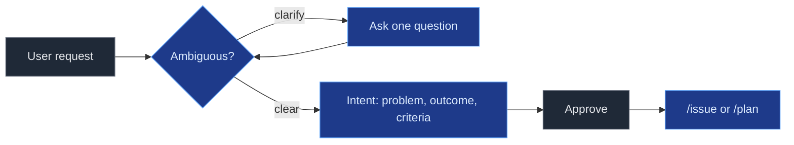
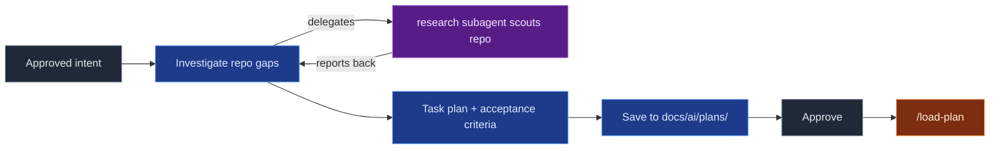

# ai-config

`ai-config` installs a repeatable, task-based AI-assisted workflow into OpenCode projects. It provides shared agents, commands, skills, and a `docs/ai/` memory convention, managed from a single CLI.

## Install

Install the CLI with the one-shot installer:

**Linux / macOS**

```bash
curl -fsSL https://github.com/Macacoders/ai-config/releases/latest/download/install.sh | sh
```

**Windows** (PowerShell)

```powershell
powershell -c "irm https://github.com/Macacoders/ai-config/releases/latest/download/install.ps1 | iex"
```

Default prefix: `~/.ai-config` (Linux/macOS) or `%LOCALAPPDATA%\ai-config` (Windows).

### Requirements

- **Node.js >= 18** is required to run the installed workflow (skills and commands execute via `npx tsx`).
- The one-shot installer provisions Node.js (>= 18) user-locally into the prefix when it is missing or too old — no manual install needed.
- `ai-config install --repo` requires Node.js >= 18 on PATH; pass `--skip-node-check` to bypass the check.

Install the runtime into a target repository:

```bash
ai-config install --repo /path/to/repo --providers openai
```

| Command | Purpose |
|---|---|
| `ai-config install --repo <path>` | Install runtime config into a repo |
| `ai-config uninstall --repo <path>` | Remove ai-config managed files from a repo |
| `ai-config interactive` | Guided interactive installer |

Use `--dry-run` to preview and `--force` to refresh managed files. Remove the CLI itself with `install.sh --uninstall` or `install.ps1 -Uninstall`.

### Use from source

Prefer a clone over the release? Run the installer straight from TypeScript source:

```bash
git clone https://github.com/Macacoders/ai-config.git
cd ai-config
npm install
npx tsx cli/src/index.ts install --repo /path/to/your-project --providers openai
```

Build a standalone binary with `make cli-binary` (no Node.js needed).

See [`RELEASE.md`](./RELEASE.md) and [`CHANGELOG.md`](./CHANGELOG.md) for release and version history.

## Use

Work flows through four workflows: formalize intent, plan approved intent, track via issues, and deliver task by task.

Node colors: gray = you · blue = `planner` · orange = `delivery` · green = `code` · purple = `research`.

### `/intent`

Formalize an ambiguous request into a bounded intent: problem, outcome, and acceptance criteria.



### `/plan`

Turn an approved intent into a concrete, task-based implementation plan.



### `/issue`

Create and track a shared GitHub Issue for a problem or idea.


### Delivery loop

Load an approved plan and implement it task by task, reviewing each step.


## Contribute

Edit source templates under `base/opencode/**`. Never edit generated `.opencode/` files (they are gitignored and overwritten on reinstall).

> **Protection rule:** Agents must never merge changes to `develop` that touch `base/opencode` markdown files for skills, agents, or commands — `base/opencode/skills/**/SKILL.md`, `base/opencode/agents/**/*.md`, and `base/opencode/commands/**/*.md`. Changes to these files must always be validated through a pull request.

Deep workflow and memory guidance is in [`docs/ai/README.md`](./docs/ai/README.md) and [`AGENTS.md`](./AGENTS.md).
